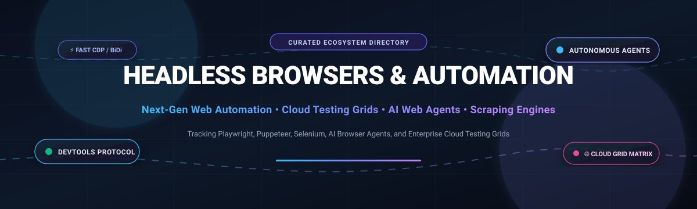
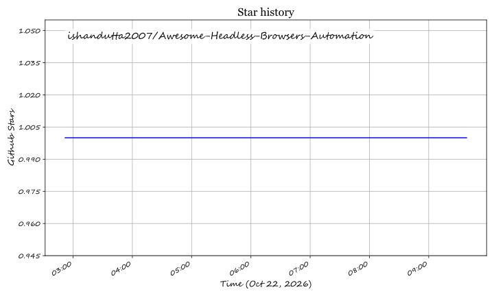

  

# 🌐 Awesome Headless Browsers & Automation 🚀

  
  
  
  
  
  
  

> 🎯 **A comprehensive, SEO-optimized curated list of top SaaS platforms and open-source GitHub repositories for Headless Browsers, Cross-Browser Testing, Web Scraping, and AI Browser Agents.**

---

## 📑 Table of Contents

- [🌟 Overview](#-overview)
- [📊 Sector Overview & Market Dynamics](#-sector-overview--market-dynamics)
- [🏢 SaaS & Hosted Cloud Testing Platforms](#-saas--hosted-cloud-testing-platforms)
- [💻 Open-Source GitHub Projects](#-open-source-github-projects)
- [🤝 How to Contribute](#-how-to-contribute)
- [💖 Support & Sponsorship](#-support--sponsorship)
- [📈 Star History](#-star-history)
- [⚖️ Disclaimer](#️-disclaimer)

---

## 🌟 Overview

Modern software delivery demands programmatic, reliable web interaction. **Headless browsers** and **browser automation frameworks** empower developers, QA automation engineers, and autonomous AI agents to drive web applications without a visual GUI. Whether executing end-to-end regression suites across thousands of mobile device profiles, rendering single-page applications (SPAs) for search engines, or executing deep autonomous web navigation, these tools form the core infrastructure of modern DevOps pipelines and intelligent agent workflows.

---

## 📊 Sector Overview & Market Dynamics

The global automated testing and browser infrastructure sector is valued between **$24B and $28B in 2026** and is accelerating at a **~16–19% CAGR**, projected to surpass **$80B+ by the early 2030s** driven by high-velocity continuous integration (CI/CD) pipelines and the explosive rise of autonomous LLM web agents. 

Market concentration dynamics reflect a **moderately concentrated, bifurcated structure**: enterprise cloud device grids demonstrate significant winner-takes-most consolidation around top hyper-scaled cloud platforms (such as BrowserStack and Sauce Labs), while the emerging AI web agent, stealth browser, and developer runtime layers remain **highly fragmented** with continuous, rapid open-source innovation.

---

## 🏢 SaaS & Hosted Cloud Testing Platforms

The table below lists leading commercial SaaS and cloud-hosted browser automation platforms, ordered by **Company Scale (Valuation / Revenue) in descending order**:

| 🏢 Platform | 💰 Pricing (Starting Tier) | 🎁 Free Tier & Trial Limits | 📈 Company Scale (Valuation / Est. Revenue) | ⚡ Key Capabilities & Infrastructure |
| :--- | :--- | :--- | :--- | :--- |
| **[BrowserStack](https://www.browserstack.com/)** | **$29/mo** (Live Desktop billed annually; Automate from $129/mo) | Free trial only: **30 mins** total Live testing (max 1 min per session/device) + **100 mins** Automate grid execution | **$4.0B Valuation** (~$230M+ ARR) | 3,500+ real desktop & mobile devices across 30,000+ cloud units; instant native support for Playwright, Cypress, Selenium, and Puppeteer with AI self-healing locators. |
| **[HeadSpin](https://www.headspin.io/)** | **$39/mo** (CloudTest Lite manual testing; Go plan from $83/mo) | Free trial only: **10 to 14 days** evaluated access upon demo/request | **~$250M Valuation** (~$15M–$20M ARR) | Real device testing cloud focused on digital experience monitoring, user QoE, packet-level network performance, and Appium/Selenium automation. |
| **[Sauce Labs](https://saucelabs.com/)** | **$39/mo** (Live manual; Virtual Cloud automated from $149/mo) | Free trial only: **28 days** duration with **60 total minutes** of automated and live testing | **~$200M–$250M Est. Valuation** (~$70M–$90M Revenue) | Enterprise continuous testing cloud providing virtual browser clusters and real mobile device labs with enterprise governance and compliance. |
| **[Perfecto (Perforce)](https://www.perfecto.io/)** | **$83/mo** (Basic web access; automated starting tiers from ~$300/mo) | Free trial only: **14 days** full platform evaluation with real mobile and browser cloud access | **$200M Acquisition Valuation** (Perforce Portfolio Subsidiary) | Enterprise-grade cloud automation testing supporting massive parallel executions, Appium/Selenium frameworks, and biometric/network condition simulation. |
| **[LambdaTest (TestMu AI)](https://www.lambdatest.com/)** | **$15/mo** (Live manual billed annually; Web Automation from $99/mo) | **Free Forever plan**: **60 mins/month** real-time browser testing (10 mins per session) + **100 mins/mo** automated testing (first month) | **$400M Valuation** (~$120M+ Global Revenue) | Rebranded to TestMu AI; high-concurrency cross-browser cloud with 10,000+ real desktop and mobile device environments and AI failure analysis. |
| **[TestingBot](https://testingbot.com/)** | **$20/mo** (Live Interactive; Automated testing from $50/mo) | Free trial only: **14 days** trial with **100 minutes** of automated testing | **Bootstrapped** (~$1M–$5M ARR) | Fast, independent real browser and physical device testing cloud with Selenium, Playwright, Puppeteer, Cypress, and WebdriverIO MCP integration. |

---

## 💻 Open-Source GitHub Projects

Curated open-source headless browser engines, automation libraries, and agent frameworks, ordered by **GitHub_Stars in descending order**:

- **[Browser Use](https://github.com/browser-use/browser-use)**   
  🤖 Open-source Python library connecting AI agents to browsers. Controls web interfaces using accessibility tree snapshots and vision models for reliable agent workflows.

- **[Playwright](https://github.com/microsoft/playwright)**   
  🎭 Microsoft's flagship cross-browser automation framework. Native support for Chromium, Firefox, and WebKit across TypeScript, Python, .NET, and Java with auto-waiting and Trace Viewer.

- **[Puppeteer](https://github.com/puppeteer/puppeteer)**   
  🎪 Google's Node.js library for controlling Chromium and Firefox via Chrome DevTools Protocol (CDP) and WebDriver BiDi. High performance for PDF generation, tracing, and scraping.

- **[Cypress](https://github.com/cypress-io/cypress)**   
  🌲 Fast, easy, and reliable end-to-end testing framework for web applications running directly inside the browser execution loop.

- **[Lightpanda](https://github.com/lightpanda-io/browser)**   
  🐼 Ultra-lightweight open-source headless browser built in C and Zig for AI agents and web scraping, consuming a fraction of the RAM of standard Chrome instances.

- **[changedetection.io](https://github.com/dgtlmoon/changedetection.io)**   
  🔍 Self-hosted website change detection, monitoring, and alerting system using Playwright and WebDriver for dynamic JavaScript rendering.

- **[Selenium](https://github.com/SeleniumHQ/selenium)**   
  ⚡ The foundational W3C WebDriver standard for browser automation. Offers the widest language support (Java, Python, C#, JS, Ruby) and drives retail browser installations.

- **[Crawlee](https://github.com/apify/crawlee)**   
  🕷️ Web scraping and browser automation library for Node.js and Python by Apify. Provides unified abstractions over Playwright and Puppeteer with built-in proxy and fingerprint rotation.

- **[Stagehand](https://github.com/browserbase/stagehand)**   
  🦾 AI web browsing SDK built on Playwright by Browserbase. Automates actions with three simple primitives: `act`, `extract`, and `observe`.

- **[Skyvern](https://github.com/Skyvern-AI/skyvern)**   
  🧠 Automates browser-based workflows using AI and computer vision, navigating dynamic websites without requiring hard-coded CSS or XPath selectors.

- **[Automa](https://github.com/AutomaApp/automa)**   
  🧩 Open-source Chrome and Firefox extension for automating web tasks via a visual drag-and-drop workflow builder.

- **[Nanobrowser](https://github.com/nanobrowser/nanobrowser)**   
  🛡️ Open-source Chrome extension for local, privacy-focused AI web automation using your own LLM API keys with no external subscriptions.

- **[Browserless](https://github.com/browserless/browserless)**   
  🐳 Dockerized headless browser infrastructure for running Chrome, Playwright, and Puppeteer workloads at scale via WebSocket endpoints.

- **[chromedp](https://github.com/chromedp/chromedp)**   
  🏎️ Fast, dependency-free Go library for driving Chrome and Chromium via DevTools Protocol without Node.js or Selenium.

- **[WebdriverIO](https://github.com/webdriverio/webdriverio)**   
  🔌 Next-gen browser and mobile automation framework for Node.js supporting WebDriver, CDP, component testing, and MCP servers.

- **[OpenBrowser](https://github.com/ntegrals/openbrowser)**   
  🐍 Python library for AI-agent browser navigation supporting OpenAI, Anthropic, Google Gemini, and local models via Ollama.

- **[Docker Selenium](https://github.com/SeleniumHQ/docker-selenium)**   
  📦 Containerized Selenium Grid images offering Chrome, Edge, and Firefox versions with VNC support for self-hosted test execution.

- **[puppeteer-extra](https://github.com/berstend/puppeteer-extra)**   
  🥷 Modular plugin framework for Puppeteer and Playwright, featuring stealth plugins to evade bot-detection heuristics.

- **[Rod](https://github.com/go-rod/rod)**   
  🎣 High-performance Go library for DevTools Protocol automation and high-concurrency web scraping.

- **[Selenoid](https://github.com/aerokube/selenoid)**   
  ⚡ Lightweight Go implementation of the Selenium hub launching isolated browsers inside Docker containers per test.

- **[Alpine Chrome](https://github.com/jlandure/alpine-chrome)**   
  🪶 Ultra-compact Docker image (~50MB compressed) running headless Chromium on Alpine Linux for serverless environments.

---

## 🤝 How to Contribute

Contributions, suggestions, and corrections are warmly welcomed! 🌟

1. **Fork** the repository on GitHub.
2. **Add or edit** entries in [`README.md`](./README.md) following the established table or list format.
3. Ensure every open-source repository includes a Stars_Badge (`style=social&color=white`) linking to its stargazers page.
4. Keep all descriptions factual, objective, and link directly to official project repositories or homepages.
5. **Submit a Pull Request** with a concise summary of your addition.

---

## 💖 Support & Sponsorship

Thank you so much for exploring and using this curated directory! 🌟 If this repository saves you time or helps your testing and automation workflow, please consider supporting the project:

- ⭐ **Star** this repository to help others discover it on GitHub.
- 🍴 **Fork** and share it with your QA, DevOps, and automation peers.
- ☕ **Buy me a coffee / Sponsor**: If you'd like to support ongoing maintenance and new features, visit the sponsor dashboard:  
    
  👉 **[Support on GitHub Sponsors (https://github.com/sponsors/ishandutta2007)](https://github.com/sponsors/ishandutta2007)**

---

## 📈 Star History

---

## ⚖️ Disclaimer

- This is a **community-curated list** for informational and educational purposes — not an endorsement.
- **Playwright vs. Puppeteer vs. Selenium**: Select your engine based on your team's specific language requirements, cross-browser scope (WebKit vs. Chromium-first), and need for retail browser testing.
- **Bot Detection & Scraping**: Most tools expose standard automation signatures (`navigator.webdriver`, CDP artifacts). Evasion requires separate architectural mitigations.
- **Cloud Infrastructure Costs**: Real-device cloud testing costs scale with concurrency slots. Balance self-hosted Docker clusters with managed cloud infrastructure based on team capacity.

---

  <b>Made with ❤️ for QA engineers, automation developers, and AI agent builders.</b>

## ⭐ Star History

<a href="https://star-history.com/#ishandutta2007/Awesome-Headless-Browsers-Automation&Timeline" align="center">
  <picture>
    <source media="(prefers-color-scheme: dark)" srcset="assets/ishandutta2007_Awesome-Headless-Browsers-Automation_growth.svg">
    
  </picture>
</a>
